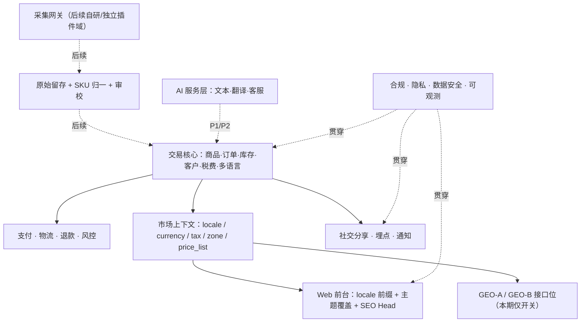
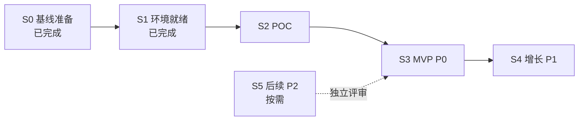

# 全球化独立站建设方案

> **版本**：统一版 v1.0（2026-11-07）｜**位置**：项目根｜**唯一现行方案文档**｜**最近进度更新**：2026-11-08（进度与阶段规划见 §11）
> **依据**：`开源电商系统评估报告.md`、`临时文件/仓库源码/innoshop/` 只读代码勘查、官网页面（2026-11-07）；评估不纳入授权条款维度。
> **约束**：后台运维界面保持简体中文（`zh-cn`）；前台面向全球客户，默认英语；本方案为讨论阶段单一现行版，变更只在本文件局部修订并在 `临时文件/报告版本/变更记录.md` 单行登记。
> **路径约定**：下文所有路径相对项目根；`临时文件/仓库源码/innoshop/` 简写为 `底座/`。包内别名：`front/`=`innopacks/front/`、`common/`=`innopacks/common/`、`panel/`=`innopacks/panel/`、`plugin/`=`innopacks/plugin/`、`restapi/`=`innopacks/restapi/`、`aicore/`=`innopacks/aicore/`、`mcp/`=`innopacks/mcp/`；`plugins/`、`themes/`、`config/` 为仓库自身目录。

---

## 0. 决策基线

| # | 已确认决策 | 落地含义 | 本期处理 |
|---|---|---|---|
| 1 | InnoShop 为**唯一交易底座** | 商品、订单、库存、结算、客户、后台全部只在此栈内；不部署第二套商城、不跨栈复制代码 | 实施 |
| 2 | 暂不开发 CRMEB 社交电商能力 | 拼团、砍价、秒杀、直播、多端小程序/APP 均不排期；仅可参考业务规则文档 | 不开发 |
| 3 | 商品采集后续自行开发 | 采集作为独立插件域；本期只定边界与数据契约，不写采集实现、不引入采集插件依赖 | 预留边界 |
| 4 | SEO 嵌入商品页；GEO 拆两项独立功能 | SEO 本期实现；GEO-A「生成式引擎优化」、GEO-B「地域定向」各自只留最小接口与开关，后续接入开源方案 | SEO 实施／GEO 预留 |
| 5 | 补齐缺失关键模块，满足中量级二开 | 支付、物流、税务、合规、数据安全、主数据、搜索、通知、工程可观测，全部按插件/钩子规范补齐 | 实施 |
| 6 | 暂不做分销；接受 PHP/Laravel 自维护与中量二开；必须支持全球化多语言与多市场 | 建立自维护（fork、迁移、测试、CI）与市场模型；分销/佣金结算不排期 | 实施 |
| 7 | 以上完成后补完整版分项改造清单与验收标准 | 见第 6、7 章 | 已补 |

**范围边界（逐项对照上一轮 7 项需求）**

| 需求 | 本期结论 |
|---|---|
| 1 AI 标题优化／图片翻译或重设计 | 文本优化列入 P1（审校后发布）；图片只做白底化、裁剪、水印清理与 Alt 本地化，生成式重设计与图内文字翻译列入后续评估 |
| 2 CRMEB 分销／拼团／直播／全端 | 全部不开发（决策 2、6） |
| 3 后台／PageBuilder／1688 采集插件 | 后台与 PageBuilder 直接采用；采集插件不作为依赖，后续自研（决策 3） |
| 4 SEO／GEO | SEO 实施；GEO 拆两项，只预留接口（决策 4） |
| 5 AI 客服与知识库 | 列入 P2：底座无 RAG/向量库，后续自建；本期只保留 `ToolInterface` 接入位 |
| 6 多语言与自动翻译 | 核心实施（第 2 章），默认英语、按市场扩语种、机翻需审校 |
| 7 社交分享与推广埋点 | 列入 P1：社交登录已有，补分享标签、统一事件字典、服务端转发与同意管理 |

> **底线冲突提示（一次）**：决策 4、5 要求「预留接口/满足扩展」，与项目主规则「不提前抽象、不预埋扩展、少依赖」冲突。本方案按底线执行——**只留最小契约**（配置开关、事件名、数据表字段、单一适配器接口），不新建抽象层/中间件全家桶、不提前安装 SDK、不改写核心包；确需扩展时在对应迭代再重构。

---

## 1. 底座与整体架构

### 1.1 唯一底座

- 技术事实：PHP `^8.3` / Laravel `^13.0`，`innopacks/` 9 包分层、插件与主题机制、Eventy 钩子、Horizon 队列、Redis、PHPStan/Pint、后台默认 `zh-cn`、前台种子 `en`；内置 5 个插件（Stripe、PayPal、BankTransfer、FixedShipping、PageBuilder）。
- 采用理由：后台中文硬约束原生满足；多语言/多币种/税率/`sitemap.xml`/`llms.txt`/AI 与 MCP 已有骨架；跨境独立站定位与本方案一致。
- 代价与对策：社区小、无 CHANGELOG/UPGRADE/SECURITY、测试与 CI 薄 → 建立自有 fork、增量迁移、回归测试与升级演练（§3.4、§9）。
- CRMEB 在本方案中只作为**规则文档参考**，不部署、不复制、不联调。

### 1.2 分层架构



### 1.3 模块边界与数据所有权

| 域 | 归属 | 允许改动方式 | 禁止 |
|---|---|---|---|
| 交易核心（商品/订单/库存/结算/客户） | `innopacks/` | 增量迁移、钩子 filter、`add_model_relation()`、主题覆盖 | 直接大改核心控制器/服务（除必要缺陷修复） |
| 扩展功能（支付/运费/费用行/SEO/市场/GEO/采集/AI 客服） | `plugins/`、`themes/` | 新插件 + `config.json`/`fields.php`/`Boot.php` | 在核心包内堆业务分支 |
| 内容（多语言文案、页面） | 翻译表 + `panel/` 表单 | `locale_field_data()` + `MetaInfo` | 硬编码中文文案 |
| 配置与密钥 | `.env`、`system_setting()`、密钥管理 | 环境变量 / 后台配置项 | 写入版本库或日志 |
| 参考源码 | `临时文件/仓库源码/` | 只读 | 原地修改参考仓库（自维护副本另建） |

### 1.4 自维护策略

1. 建立私有 fork 与 `upstream` 跟踪；所有二开集中在 `plugins/`、`themes/`、独立迁移与测试，降低合并冲突。
2. 升级流程：锁版本 → 拉 upstream 小版本 → 跑 `php artisan test` + Pint + 自有功能测试 → 沙箱回归 → 合并；不跳版本升级。
3. 补治理文件（仓库缺）：`CHANGELOG.md`、`UPGRADE.md`、`SECURITY.md`、依赖漏洞扫描与季度升级演练。
4. 前台默认 `zh-cn` 后台不动；前台默认英语由 `SettingSeeder` 与 `front_locale_code()` 明确配置，避免 session 探测造成同 URL 不同语言（§2.3）。

---

## 2. 全球化多语言与多市场设计

### 2.1 现状与缺口

| 能力 | 已有实现 | 缺口 |
|---|---|---|
| 界面多语言 | `lang/` 多组面板语言包、后台默认 `zh-cn` | 前台新文案需逐条补翻译 |
| 业务内容多语言 | `product_translations` 等各实体翻译表、`locale_field_data()`、`MetaInfo`、`ProductRepo::handleTranslations()` | 译文无审校状态、无术语表/翻译记忆、源变更不触发重审 |
| URL 与索引 | `FrontServiceProvider::registerWebRoutes()` 按 `locales()` 注册 `prefix($code)`；`SetFrontLocale` 支持 URL 首段 + Accept-Language + session + `APP_LOCALE_FORCE` | 无 canonical/hreflang；`sitemap.xml` 无 alternates；session 探测与爬虫地域可能不一致 |
| 多币种 | `currencies.value` 汇率换算，`current_currency()`、`currency_format()`，订单快照 `currency_code/currency_value` | **商品主表无多币种价格列**，无法按市场独立定价；汇率需接实时源 |
| 税费 | `TaxClass/TaxRate/TaxRule`、`common/src/Libraries/Tax.php` 按地址匹配 `tax_rules`、`FeeService` 汇总 | 需 VAT/GST/Sales tax 判定、含税/价外展示、VAT 号与 IOSS 场景 |
| 市场维度 | `locales`、`currencies`、`states/regions` | **无 Market/Channel 模型**，locale/currency/tax/shipping/payment/compliance 无法按市场成组配置 |
| 本地化细节 | 日期/货币格式、地区数据 | 时区、地址格式、英制/公制、RtL、禁售品与合规标记、市场级可售性 |

### 2.2 目标模型：Market（市场）为第一公民

新增独立迁移与模型 `markets`（不改动主迁移 `2024_04_01_161034_init_innoshop_table.php`）：

| 字段 | 含义 |
|---|---|
| `code` | 市场码（如 `us`、`de`、`jp`），唯一 |
| `default_locale` / `locales[]` | 默认语言与允许语言列表 |
| `currency_code` / `price_list_id` | 结算币种与价格表 |
| `tax_region_id` / `tax_mode` | 税区与含税/价外展示 |
| `shipping_zone_id` / `allowed_shipping_codes[]` | 配送区域与可用运费方式 |
| `allowed_payment_codes[]` | 市场可用支付方式 |
| `compliance_flags[]` | 禁售品类、产品安全责任人、包装/环保、年龄警示 |
| `domains[]` / `url_strategy` | 域名或路径策略（`/de/`、`de.example.com`） |
| `timezone` / `date_format` / `unit_system` / `rtl` | 本地化参数 |

**市场上下文解析顺序**（本期实现解析骨架，GEO-B 只预留增强接口）：显式 URL/账户地址 > 已保存偏好 > `Accept-Language` > 站点默认英语。所有下游（币种、税率、运费、可售商品、支付方式、合规文案）只读同一 `MarketContext`，避免各模块各自判断。

### 2.3 URL 与索引策略

- 保持现有 `/{locale}/...` 前缀；英语默认市场可隐藏前缀，但**必须**保证每种语言有唯一稳定 URL，禁止靠 session 返回不同语言内容。
- 每个页面输出自引用 `canonical` + 全量 `hreflang`（含 `x-default`），由 `enabled_locale_codes()` 生成；筛选/排序/分页参数、内部搜索结果、采集预览页不索引。
- `sitemap.xml` 按市场/语言分片并加 alternates；商品数超过 1000 时按 `sitemap_index` 分页（现有 `SitemapService` 每类 `limit(1000)`）。
- 静态资源 CDN 缓存键包含 `locale + market + currency`；`cache_key()` 已带 locale 维度，扩展 market 维度即可。

### 2.4 内容三层与审校状态机

| 层 | 存储 | 规则 |
|---|---|---|
| 界面文案 | `lang/{locale}/`、主题 `lang/` | 新增文案必须同步所有启用语种；后台固定 `zh-cn` |
| 业务内容 | 各实体 `*Translation` 表 | 机翻草稿 `draft` → 人工审校 `reviewed` → 发布 `published`；原文变更自动回退为 `draft` |
| URL/SEO | `slug` / `meta_*` / `canonical_url` / `og_image` | 每 locale 独立，缺失时按市场回退到英语，不生成空标签 |

配套：术语表（品类/材质/电压/尺码/安全警示）、翻译记忆与缓存、AI 批量生成走 `aicore/src/Http/Controllers/Panel/ContentAIController.php::generateBatch()`（按 locale 一次生成）、`GenerateProductContentJob` 队列模板；译文与原文版本绑定，避免重复调用付费接口。

### 2.5 价格、税费、运费、关税

- 新增 `market_prices`（商品/SKU × 市场 × 币种）覆盖汇率换算；汇率换算保留为回退，订单继续存 `currency_code/currency_value` 快照。
- 税费：扩展 `Tax.php` 的 `getRates()` 与 `common/src/Services/Fee/Tax.php::addFee()`，按 `MarketContext.tax_region_id` 判定；含税价与价外税在商品页/购物车/结账三处展示一致。
- 运费/关税：新增运费插件实现 `getQuotes(ShippingEntity)`；关税与手续费作为费用行经 `service.checkout.fee.methods` 注入 `FeeService`，不改写结账核心。
- **定价模型前置校验**：2026 年美国低值免税待遇已终止、欧盟自 2026-07-01 取消 150 欧以下关税豁免；立项 POC 必须以「含关税 + 运费 + 退货 + 拒付 + 佣金」重算单件毛利，否则低价铺货模型不成立。

### 2.6 本地化清单

默认英语；按市场扩语种。必须覆盖：货币符号与小数位、日期/时区、地址字段与校验、公制/英制与电压/尺码换算、RtL 布局（阿语）、多语言邮件与通知模板、图片 Alt 与无障碍、本地支付方式、市场级禁售品与警示语、客服时区与 SLA。

---

## 3. 中量级二开扩展规范

### 3.1 底线

优先 Laravel 原生能力（队列、事件、通知、缓存、验证、Blade、迁移、Sanctum）与底座已有钩子；短逻辑手写，不引入全家桶/重型 SDK，不为「以后可能用」建抽象层。所有新功能通过插件/主题/增量迁移落地，保证「不改核心包」可通过验收。

### 3.2 五类扩展点

| 类型 | 契约 | 主要路径 |
|---|---|---|
| 插件 | `config.json`（`type` ∈ payment/shipping/price/orderfee/marketing/service/feature）+ `fields.php` + `Boot::init()` + `Views/` + `Routes/{front,front-api,panel,panel-api,root,main}.php` + `Lang/` | `plugin/src/PluginServiceProvider.php`、`plugin/src/Core/Plugin.php`、`plugin/src/Repositories/PluginRepo.php` |
| 钩子 | `fire_hook_filter` / `listen_hook_filter`、`fire_hook_action` / `listen_hook_action`、`listen_blade_insert/update`；Blade `@hookinsert` / `@hookupdate`；`ContentFilterHook` 生成 `<controller>.response` 过滤器可无侵入注入 head | `plugin/helpers.php`、`common/src/Middleware/{EventActionHook,ContentFilterHook}.php` |
| 支付方式 | `type=payment`；Web `service.payment.pay.{code}.view/.data`、API `service.payment.api.{code}.data`、移动端 `service.payment.mobile_pay.data`；回调路由命名含 `callback` 免 CSRF | `front/src/Services/PaymentService.php`、`common/src/Services/Checkout/BillingService.php`、`plugins/{Stripe,PayPal,BankTransfer}/` |
| 运费与费用行 | `Boot::getQuotes(ShippingEntity): array` 返回 `type/code/name/description/icon/cost/cost_format`；费用行挂 `service.checkout.fee.methods` | `common/src/Services/Checkout/{ShippingService,FeeService}.php`、`plugins/FixedShipping/Boot.php` |
| 主题与 API | `themes/{code}/views/` 覆盖同名 blade（主题优先）、`themes/{code}/boot.php` 返回 callable、主题 `routes/{root,front}.php`；后台接口放 `restapi/routes/panel-api.php` 的 `auth:sanctum + EnsureUserIsAdmin` 组 | `front/src/FrontServiceProvider.php`、`restapi/src/RestapiServiceProvider.php` |

其他：`add_model_relation()` 动态挂关系；`common/src/Models/Product/Sku.php::getFinalPrice()` 暴露 `model.sku.final_price` 改价；AI/MCP 工具实现 `ToolInterface`（`isWrite()` 区分读写）并经 `ai.tools` 钩子注册；MCP 侧由 `mcp/src/McpAccess.php` 按 `mcp_write_enabled` 过滤写工具。

### 3.3 最小接口契约（本期只预留，不实现）

```yaml
# 配置开关（system_setting，本期全部 false，不产生行为）
geo_generative_enabled: false   # GEO-A 生成式引擎优化
geo_targeting_enabled: false    # GEO-B 地域定向
supplier_gateway_enabled: false # 采集网关（后续自研）

# GEO-A：生成式引擎优化（后续接入开源方案）
event: geo.generative.content_ready
input:  { entity_type, entity_id, locale, market_code, content_snapshot }
output: { canonical_url, entity_ids[], claims[], faq[], citations[], updated_at }
adapter: GenerativeEngineAdapter::build(snapshot) -> structured_answer
landing: front/resources/views/products/show.blade.php @push('header') + front/src/Services/LlmsService.php
rule: 只读商品/分类/文章译文快照，不写交易表；经 ai.tools 或 ContentFilterHook 注入

# GEO-B：地域定向（后续接入开源方案）
event: geo.targeting.resolved
output: { market_code, locale, currency_code, tax_region_id, shipping_zone_id,
          price_list_id, allowed_payment_codes[], compliance_flags[], confidence, source }
landing: SetFrontLocale 之后的中间件（后续新增）；本期仅 markets 表与事件字典占位
rule: 本期不改变价格/税费/可售性计算；启用前必须通过 §7.3 全球化验收矩阵

# 采集网关（后续自研，独立插件域）
stages: raw_json 留存 -> 字段/SKU/单位/重量/图片归一 -> draft/reviewed/published -> 发布
publish: restapi/routes/panel-api.php 的 /products/import 或 common/src/Repositories/ProductRepo.php
sync: 价格/库存增量同步走队列，禁止用一次性快照覆盖在售商品
rule: 不写 innopacks 核心；本期不开发

# 统一事件字典（P1 埋点共用）
view_item / add_to_cart / begin_checkout / purchase / refund / consent_changed
```

### 3.4 工程规范

- 分支与迁移：一个功能一个增量迁移，禁止改主迁移；迁移必须可回滚，字段带 `market_code`/`locale` 维度。
- 队列与缓存：默认 `database`，生产切 Redis（`config/queue.php`、`config/cache.php`）；新增 `config/horizon.php` 与 supervisor 白名单；耗时任务一律 `ShouldQueue` + `WithoutOverlapping`（参考 `aicore/src/Jobs/GenerateProductContentJob.php`）。
- 通知：`common/src/Services/Notification/NotificationManager.php::registerChannel()` 加渠道，邮件模板放主题目录。
- 测试与 CI：`phpunit.xml` 现仅含 8 个包且 `source` 只有 `app/`，需补 `innopacks/mcp/tests` 与根 `tests/`；复用 `tests/Traits/{CreatesAdmin,CreatesCustomer,CreatesOrder,CreatesProduct,MocksPayment}.php`；CI 在 `.github/workflows/laravel.yml` 增加 Pint 与静态分析。
- 配置与密钥：`.env` 只放环境差异；AI/支付/物流/采集 Token 走密钥管理，禁止入库、入日志、入前端；后台配置项用 `system_setting()`。
- 文档：每个插件一份 `README`，记录钩子名、配置项、迁移、回滚与验收命令。

---

## 4. 关键模块补齐

| 模块 | 现状证据 | 最小实现 | 扩展点 | 阶段 | 缺失后果 |
|---|---|---|---|---|---|
| 支付 | `plugins/{Stripe,PayPal,BankTransfer}` + `PaymentService` | 保留内置；补本地方式、3DS/SCA、回调幂等、退款/部分退款、拒付与争议、对账、多币种金额与汇率快照 | 新增 `type=payment` 插件 | P0 | 收不到款、重复扣款、拒付爆表 |
| 物流履约 | 仅 `plugins/FixedShipping`；`ShippingService::getMethods()` | 实时运费、体积重、承运商与轨迹回传、多仓/代发、DDP/DDU、HS code、退货 RMA 与逆向物流、追踪号通知 | `getQuotes()` + 费用行钩子 | P0 | 运费倒挂、无法追踪、退货失控 |
| 税务与定价 | `TaxClass/TaxRate/TaxRule`、`Tax.php`、`Fee/Tax.php` | 按市场税区判定、含税/价外一致展示、订单税快照、VAT/GST 号校验、IOSS 场景、关税费用行 | `service.checkout.fee.methods` | P0 | 定价错误、税务合规风险 |
| 合规 | 无 Cookie 同意管理、无合规标记模型 | CMP（默认拒绝非必要 Cookie）、按 locale 的隐私/条款/退货政策、GPSR 责任人与警示语字段、EPR/包装、禁售品拦截、图片/文案使用权记录、消费者撤回权与数据删除/导出 | 设置项 + 商品扩展字段 | P0 | 下架、罚款、广告账户封禁 |
| 数据安全 | Spatie permission（`Admin` HasRoles）、Sanctum；**无审计日志模型** | 密钥管理、传输/静态加密、RBAC 最小权限、关键操作审计日志、备份与恢复演练、依赖漏洞扫描、限流/WAF/防刷、日志脱敏、留存与删除策略、MCP 写工具开关 | `EventActionHook` 落库、`config/permission.php` | P0 | 越权、泄露、无法回滚 |
| 商品主数据 | `Product`/`Product\Sku`/`MediaFile`；图片集无 `alt`；搜索为 SQL LIKE，无全文索引 | SKU 归一、单位/重量换算、图片存储与 CDN、Alt 全覆盖、上下架状态、库存预留与超卖防护、`market_prices`、搜索增强（DB 全文或后续开源检索方案） | `ProductRepo` 钩子、`MediaFile.alt` | P0/P1 | 超卖、图片成本失控、找不到商品 |
| 交易运营 | `OrderNew/OrderUpdate` 通知与邮件模板、评价模型 | 订单状态机、售后退款/换货、交易邮件与弃购挽回、评价审核、促销与优惠券、客户地址簿 | `NotificationManager`、插件 | P1 | 转化与复购断层 |
| 触达与埋点 | `SocialController`（Socialite）、`socials` 后台配置；前台无 OG/Twitter Card | 分享卡片与深链、UTM/subid、统一事件字典、GA4/Meta CAPI/TikTok Events API/Google Ads、服务端转发与 `event_id` 去重、同意模式联动 | 主题覆盖 + 队列 | P1 | 归因缺失、投放无法优化 |
| AI 内容/客服 | `aicore`（ProviderRegistry、ToolRegistry、ContentAgent、图像驱动）、`mcp`；**无 RAG/向量库/知识库** | P1 文本优化（审校后发布）；P2 自建知识库 + 低权限工具 + 人工兜底 | `ai.tools`、`ToolInterface` | P1/P2 | 内容质量与客服效率 |
| 工程可观测 | `phpunit.xml`、Pint、1 个 CI、Horizon 门禁 | 测试/CI 补齐、灰度与回滚、监控告警、Core Web Vitals、备份演练、治理文件 | `.github/workflows/`、`config/horizon.php` | P1 | 小社区自维护下易出事故 |
| 主体与组织 | 无 | 收款主体/商标/域名/广告账户一致性、多币种结算与汇兑、人工审校资源、客服时区 SLA | 运营配置 | P0 | 收款与投放被卡 |

---

## 5. SEO 商品页嵌入与 GEO 接口预留

### 5.1 SEO（本期实现）

| 改造 | 路径 | 内容 |
|---|---|---|
| 站点级 head | `front/resources/views/layouts/app.blade.php`（`@stack('header')` 约 49 行、`@hookinsert('front.layout.app.head.bottom')` 约 51 行） | 输出 canonical、hreflang（含 `x-default`）、OG/Twitter 默认值、`Organization`/`WebSite` JSON-LD；从 `common/src/Libraries/MetaInfo.php` 取值（其 `getOgImage()` 已实现但未被调用） |
| 商品页 head | `front/resources/views/products/show.blade.php`（约 8 行 `@push('header')`） | `Product`（`sku`/`brand`/`offers`/`aggregateRating` 有数据才输出）、`Offer`（价格含币种、库存状态、含税标记）、`BreadcrumbList`；canonical 指向带 locale 的 slug URL；OG image 取商品主图 |
| 分类/文章页 | `front/resources/views/categories/show.blade.php` 等 | 同上，输出 `CollectionPage`/`ItemList` 与面包屑 |
| 图片与无障碍 | `front/resources/views/products/components/_images.blade.php` | 用 `MediaFile.alt` 补 `alt`（当前无 alt），并做尺寸与懒加载 |
| 字段与写入 | `panel/src/Requests/ProductRequest.php`、`common/src/Repositories/ProductRepo.php`、`panel/resources/views/products/panes/tab_pane_seo.blade.php` | 增加 `canonical_url`、`og_image`、多语言 slug 校验；保留现有 `slug` 唯一校验与 `meta_*` 多语言字段 |
| sitemap / robots / llms | `front/src/Services/{SitemapService,RobotsService,LlmsService}.php`、`front/routes/root.php` | 解除 `limit(1000)` 并分片加 alternates；`robots.txt`/`llms.txt` 由静态文件改为动态路由（现由 `panel/src/Controllers/SettingController.php::update()` 写文件）；后台 `robots_custom_rules`/`llms_custom_content` 保留 |
| 索引与性能 | `config/cache.php`、CDN | 筛选/排序/分页参数、内部搜索、采集预览不索引；head 片段缓存键含 `locale + market`；避免第三方脚本拖慢 Core Web Vitals |

> SEO 与 GEO-A 共用 `llms.txt`/结构化数据落地槽，但**本期只实现 SEO**，不生成任何 GEO 内容。

### 5.2 GEO-A / GEO-B

两项**互相独立**、各自独立开关与适配器，互不构成前置依赖；本期均不安装依赖、不注册服务、不产生前台输出，仅保留 §3.3 的配置开关、事件名、数据形状与落地槽。后续接入开源方案时以插件形式实现，验收按 §7.2 的 GEO 条目执行。

### 5.3 明确不开发

分销与佣金结算、拼团/砍价/秒杀、直播、小程序/APP 全端、1688 采集插件集成、GEO 两项实现、RAG 知识库实现（P2 另排）。

---

## 6. 完整版分项改造清单

> 类型：`新`=新增、`改`=局部修改、`配`=配置、`留`=仅预留接口/开关。工作量为**人日估算**，用于排期，不作为承诺。依赖列引用本表编号。

| 编号 | 模块 | 改造项 | 主要路径 | 类型 | 阶段 | 依赖 | 估算 |
|---|---|---|---|---|---|---|---|
| A01 | 底座 | 建立私有 fork 与 upstream 跟踪、分支与合并规范 | 仓库外流程 | 配 | P0 | — | 2 |
| A02 | 底座 | 补 `CHANGELOG/UPGRADE/SECURITY` 与依赖漏洞扫描 | 仓库根 | 新 | P0 | A01 | 2 |
| A03 | 底座 | 前台默认语言固定英语、关闭 session 探测造成的漂移 | `common/helpers.php`、`front/src/Middleware/SetFrontLocale.php`、`database/seeders/SettingSeeder.php` | 改 | P0 | — | 2 |
| A04 | 底座 | 主题骨架与覆盖规范（`vendor:publish --tag=views`） | `themes/{code}/` | 新 | P0 | — | 3 |
| B01 | 市场模型 | 新增 `markets` 迁移/模型/后台设置页 | `common/database/migrations/`、`common/src/Models/`、`panel/` | 新 | P0 | — | 5 |
| B02 | 市场模型 | `MarketContext` 解析与统一读取（含 locale/currency/tax/zone/payment/compliance） | `common/src/`、`front/src/Middleware/` | 新 | P0 | B01 | 5 |
| B03 | 市场模型 | 多语言 URL 策略与 `front_route()` 扩展 | `front/src/FrontServiceProvider.php`、`common/helpers.php` | 改 | P0 | B02 | 3 |
| B04 | 市场模型 | `market_prices` 多币种定价表与回退逻辑 | `common/database/migrations/`、`common/src/Models/Product/Sku.php` | 新 | P0 | B01 | 5 |
| B05 | 市场模型 | 汇率源接入与订单汇率快照校验 | `common/src/Libraries/Currency.php`、`config/services.php` | 改 | P0 | B04 | 3 |
| B06 | 市场模型 | 时区/日期/地址/单位/RtL/本地格式 | `common/helpers.php`、主题视图与 CSS | 改 | P1 | B02 | 5 |
| C01 | 内容多语言 | 译文审校状态机（draft/reviewed/published + 源变更回退） | 各 `*/Translation.php`、`panel/src/Services/TranslationService.php` | 改 | P0 | — | 5 |
| C02 | 内容多语言 | 术语表 + 翻译记忆 + AI 批量生成与缓存 | `aicore/src/Http/Controllers/Panel/ContentAIController.php`、`aicore/src/Jobs/GenerateProductContentJob.php` | 新 | P1 | C01 | 5 |
| C03 | 内容多语言 | 后台新文案全语种同步检查（含简体中文后台不变） | `lang/`、`panel/resources/views/` | 配 | P0 | C01 | 2 |
| C04 | 内容多语言 | 多语言邮件/通知模板与客服时区 | `front/resources/views/mails/`、`themes/{code}/views/mails/` | 新 | P1 | C01 | 3 |
| D01 | SEO | 站点级 head（canonical/hreflang/OG/Twitter/JSON-LD） | `front/resources/views/layouts/app.blade.php`、`common/src/Libraries/MetaInfo.php` | 改 | P0 | B03 | 4 |
| D02 | SEO | 商品页 `Product`/`Offer`/`BreadcrumbList` 嵌入 | `front/resources/views/products/show.blade.php` | 改 | P0 | D01 | 4 |
| D03 | SEO | 分类/文章页结构化数据与 canonical | `front/resources/views/categories/show.blade.php` 等 | 改 | P0 | D01 | 2 |
| D04 | SEO | 图片 Alt 全覆盖与懒加载 | `front/resources/views/products/components/_images.blade.php`、`common/src/Models/MediaFile.php` | 改 | P0 | — | 2 |
| D05 | SEO | `canonical_url`/`og_image`/多语言 slug 字段与校验 | `panel/src/Requests/ProductRequest.php`、`common/src/Repositories/ProductRepo.php` | 改 | P0 | D01 | 3 |
| D06 | SEO | sitemap 分片 + alternates + 图片 sitemap，解除 1000 上限 | `front/src/Services/SitemapService.php`、`front/routes/root.php` | 改 | P0 | B03 | 4 |
| D07 | SEO | robots/llms 动态路由与索引策略（参数页不索引） | `front/src/Services/{RobotsService,LlmsService}.php`、`panel/src/Controllers/SettingController.php` | 改 | P0 | D06 | 3 |
| D08 | SEO | head 片段缓存（键含 locale+market）与 CWV 基线 | `config/cache.php`、CDN 配置 | 配 | P1 | D01 | 2 |
| E01 | GEO 预留 | `geo_generative_enabled` 开关 + 事件名 + 适配器契约 + 落地槽占位 | `panel/resources/views/settings/`、`common/config/innoshop.php`、`plugin/helpers.php` 文档 | 留 | 预留 | D02 | 1 |
| E02 | GEO 预留 | `geo_targeting_enabled` 开关 + `MarketContext` 输出形状 + 事件名 | `panel/resources/views/settings/`、`common/src/` | 留 | 预留 | B02 | 1 |
| E03 | 采集边界 | 原始留存/归一/审校/发布/增量同步的数据契约与队列位 | `plugins/`（目录占位）+ `restapi/routes/panel-api.php` 说明 | 留 | 预留 | F03 | 1 |
| F01 | 支付 | 内置 PayPal/Stripe/银行转账沙箱联调与回调幂等 | `plugins/{Stripe,PayPal,BankTransfer}/`、`front/src/Services/PaymentService.php` | 改/配 | P0 | A01 | 5 |
| F02 | 支付 | 新增本地支付插件（按市场放行）+ 3DS/SCA | `plugins/{code}/` | 新 | P0 | B02,F01 | 6 |
| F03 | 支付 | 退款/部分退款、拒付争议、对账与多币种金额校验 | `common/src/Services/Checkout/`、`panel/` | 新 | P0 | F01 | 5 |
| G01 | 物流 | 实时运费插件（`getQuotes`）+ 体积重/免邮门槛 | `plugins/{code}/`、`common/src/Services/Checkout/ShippingService.php` | 新 | P0 | B02 | 6 |
| G02 | 物流 | 承运商轨迹回传、多仓/代发、追踪号通知 | `common/src/Services/Notification/`、`plugins/` | 新 | P0 | G01 | 5 |
| G03 | 物流 | HS code、DDP/DDU、退货 RMA 与逆向物流 | `plugins/`、`panel/` | 新 | P1 | G01 | 5 |
| H01 | 税费 | 按市场税区判定、含税/价外三处一致展示、订单税快照 | `common/src/Libraries/Tax.php`、`common/src/Services/Fee/Tax.php` | 改 | P0 | B02 | 5 |
| H02 | 税费 | 关税/手续费费用行、VAT/GST 号校验、IOSS 场景 | `common/src/Services/Checkout/FeeService.php` | 新 | P0 | H01 | 4 |
| H03 | 定价 | 含关税/运费/退货/拒付/佣金的单件毛利模型与 POC 校验 | 运营测算 + `market_prices` | 配 | P0 | B04,G01,H02 | 3 |
| I01 | 合规 | CMP（默认拒绝非必要 Cookie）+ 同意模式联动 | `themes/{code}/views/`、`bootstrap/app.php` | 新 | P0 | — | 4 |
| I02 | 合规 | 按 locale 的隐私/条款/退货政策与消费者撤回权 | `panel/`、`front/resources/views/` | 新 | P0 | C01 | 3 |
| I03 | 合规 | 商品合规字段（GPSR 责任人、警示语、EPR/包装、禁售品）与市场放行 | `common/database/migrations/`、`panel/src/Requests/ProductRequest.php` | 新 | P0 | B02 | 5 |
| I04 | 合规 | 图片/文案使用权记录、数据导出与删除请求流程 | `common/src/Models/MediaFile.php`、`restapi/routes/panel-api.php` | 新 | P1 | I01 | 4 |
| J01 | 安全 | 密钥管理、日志脱敏、传输/静态加密配置 | `.env`、`config/`、日志管道 | 配 | P0 | — | 3 |
| J02 | 安全 | RBAC 权限点细化、越权测试、MCP 写工具开关与工具级鉴权 | `config/permission.php`、`mcp/src/McpAccess.php`、`aicore/src/Contracts/ToolInterface.php` | 改 | P0 | — | 4 |
| J03 | 安全 | 审计日志（关键操作落库） | `common/src/Middleware/EventActionHook.php`、新迁移 | 新 | P0 | J02 | 4 |
| J04 | 安全 | 备份与恢复演练、限流/WAF/防刷、依赖漏洞扫描 | 运维配置 | 配 | P0 | A02 | 3 |
| K01 | 主数据 | SKU/单位/重量归一、库存预留与超卖防护 | `common/src/Models/{Product,Product/Sku}.php` | 改 | P0 | — | 5 |
| K02 | 主数据 | 图片存储与 CDN、Alt 与版权字段 | `common/src/Services/{ImageService,MediaUrlResolver,StorageService}.php`、`restapi/src/Services/OSSService.php` | 改 | P0 | D04 | 4 |
| K03 | 主数据 | 搜索增强（先 DB 全文，后续可换开源检索） | `common/src/Repositories/ProductRepo.php`、`front/src/Controllers/ProductController.php` | 改 | P1 | — | 5 |
| L01 | 运营 | 订单状态机、售后退款/换货、评价审核 | `common/src/Models/Order.php`、`panel/` | 改 | P1 | F03 | 5 |
| L02 | 运营 | 交易邮件/弃购挽回、通知渠道扩展 | `common/src/Services/Notification/NotificationManager.php` | 新 | P1 | C04 | 3 |
| M01 | 触达 | 社交分享卡片、深链、UTM/subid | `themes/{code}/views/`、`front/src/Controllers/Account/SocialController.php` | 改 | P1 | D01 | 3 |
| M02 | 触达 | 统一事件字典 + 服务端转发 + `event_id` 去重 + 同意模式 | `plugins/{analytics}/`、队列 | 新 | P1 | I01 | 6 |
| N01 | AI | 文本优化（标题/卖点/meta）走审校后发布 | `aicore/src/Agents/ContentAgent.php`、`panel/` | 改 | P1 | C02 | 4 |
| N02 | AI | 知识库 + 低权限工具 + 人工兜底（后续阶段） | `plugins/{support}/`、`ToolInterface` | 新 | P2 | J02 | 8 |
| O01 | 工程 | 测试套件补齐（含 mcp/tests、根 tests/）、Pint 与静态分析进 CI | `phpunit.xml`、`pint.json`、`.github/workflows/laravel.yml` | 改 | P0 | A01 | 4 |
| O02 | 工程 | 队列/缓存切 Redis、Horizon 配置与告警 | `config/{queue,cache,horizon}.php`、`app/Providers/HorizonServiceProvider.php` | 配 | P0 | — | 3 |
| O03 | 工程 | 灰度/回滚、监控告警、CWV 基线 | 运维配置 | 配 | P1 | O02 | 4 |
| P01 | 组织 | 主体/商标/域名/广告账户一致性、审校与客服资源 | 运营流程 | 配 | P0 | — | 2 |

---

## 7. 完整版验收标准

### 7.1 通用工程验收

| 编号 | 验收项 | 通过条件 |
|---|---|---|
| V-G1 | 不改核心包 | 新增功能全部可仅由 `plugins/`、`themes/`、独立迁移、测试与配置项复现；`git diff` 对 `innopacks/` 的改动仅限缺陷修复与必要接线，且逐条登记理由 |
| V-G2 | 测试与 CI | `php artisan test` 全绿；Pint 无差异；CI 覆盖测试+格式+静态分析；新增功能均有 Feature/Unit 测试 |
| V-G3 | 迁移可回滚 | 每个新迁移 `up/down` 均可在测试库执行；回滚后站点可用 |
| V-G4 | 队列与幂等 | 耗时任务入队；支付回调、通知、同步任务重复投递不产生重复副作用 |
| V-G5 | 部署与回滚 | 存在可复现部署清单、备份恢复演练记录、回滚耗时上限（≤30 分钟估算） |
| V-G6 | 密钥与日志 | 全库与日志扫描无明文密钥/Token；支付卡数据不落自有库 |

### 7.2 分模块验收

| 编号 | 验收项 | 判定方法 / 通过条件 |
|---|---|---|
| V-B1 | 市场模型 | 新增一个市场后，locale/currency/tax/zone/payment/compliance 全部由 `MarketContext` 统一给出，无需改代码 |
| V-B2 | 多语言 URL | 每个启用语种有唯一稳定 URL；同一 URL 匿名/登录/不同 UA 返回同一语言；`hreflang` 双向成对且含 `x-default` |
| V-B3 | 多币种定价 | 同一 SKU 在两个市场显示各自价格；汇率变动不影响已下订单金额（订单快照一致） |
| V-B4 | 译文审校 | 机翻内容不会直接进入前台；原文变更后译文自动回退 `draft`；审校记录可追溯 |
| V-B5 | 本地化 | 日期/时区/地址/单位/RtL/货币格式按市场正确；多语言邮件模板无中文串台；后台仍为简体中文 |
| V-D1 | 商品页 SEO | 商品页含 `Product`+`Offer`+`BreadcrumbList` JSON-LD，通过结构化数据校验；价格/币种/库存与页面一致 |
| V-D2 | canonical/hreflang | 每页自引用 canonical 唯一；带筛选参数页不产生新 canonical；hreflang 覆盖全部启用语种 |
| V-D3 | 分享卡片 | OG/Twitter 抓取调试器可正确取标题、描述、图片；缺图时有默认图 |
| V-D4 | 图片 Alt | 商品图集与详情图 `alt` 覆盖率 100%；无空 `alt` 的商品主图 |
| V-D5 | sitemap/robots | 商品数 >1000 时自动分片并全部收录；`robots.txt`/`llms.txt` 动态可访问；参数页/内部搜索/采集预览不被索引 |
| V-D6 | 性能 | 商品页 CWV 基线达标（LCP/CLS/INP 记录基线值），第三方脚本不阻塞首屏 |
| V-E1 | GEO 接口预留 | 两个开关默认关闭且站点行为与关闭前一致；事件名、数据形状、落地槽有文档与测试占位；无新增依赖 |
| V-E2 | 采集边界 | 契约文档通过评审；本期无采集代码、无采集依赖；`products/import` 可手工导入一条样本商品 |
| V-F1 | 支付 | 沙箱完成下单→支付→回调→订单状态；重复回调幂等；退款/部分退款成功；3DS 场景不卡单 |
| V-F2 | 支付对账 | 多币种金额、汇率快照与网关账单一致；拒付/争议有登记与处理入口 |
| V-G1 | 运费 | 两个不同市场/重量返回不同报价；免邮门槛与体积重计算与规则一致；结账金额与报价一致 |
| V-G2 | 履约 | 追踪号可回传并在订单页展示；退货 RMA 全流程可走通；DDP/DDU 在结账页明确展示 |
| V-H1 | 税费 | 商品页/购物车/结账三处含税口径一致；不同税区税率正确；订单保存税快照 |
| V-H2 | 定价模型 | POC 出具含关税/运费/退货/拒付/佣金的毛利测算，结论为正才进入 MVP |
| V-I1 | 同意管理 | 首次访问默认拒绝非必要 Cookie；拒绝前不加载统计/广告脚本；同意可撤回 |
| V-I2 | 合规页面 | 各语种隐私/条款/退货政策可访问；GPSR 责任人、警示语、禁售品拦截生效 |
| V-I3 | 数据权利 | 导出/删除请求在约定时限内完成，且审计留痕 |
| V-J1 | 权限与审计 | 越权用例（跨用户订单、后台接口、MCP 写工具）全部被拒；关键操作有审计记录 |
| V-J2 | 安全基线 | 备份可恢复；限流/WAF/防刷生效；依赖扫描无高危未处理项；日志无 PII 明文 |
| V-K1 | 主数据 | 并发下单不超卖；SKU 与单位换算正确；图片走 CDN 且 Alt 与版权字段齐全 |
| V-K2 | 搜索 | 关键词/筛选/排序结果正确；大数据量下列表响应时间有记录基线 |
| V-M1 | 埋点 | 事件字典字段完整、服务端转发与 `event_id` 去重生效；同意状态影响事件发送 |
| V-N1 | AI 文本 | AI 生成内容默认草稿，审校后才发布；可回滚到上一版本；术语表生效 |

### 7.3 全球化验收矩阵

| 维度 | 最低覆盖 | 通过条件 |
|---|---|---|
| 语言 | 英语（默认）+ 至少 1 个非拉丁语种 + 1 个 RtL 语种 | 三层内容、URL、SEO 标签、邮件、后台（中文）均正确 |
| 市场 | 至少 3 个（如 US / EU / 亚太） | 各自 currency、tax、shipping、payment、compliance 独立且可切换 |
| 币种 | 至少 3 种 | 展示、计算、订单快照、退款金额一致 |
| 税费 | 含税市场与价外税市场各 1 | 三处展示一致、税快照正确 |
| 支付 | 每市场 ≥1 种可用方式 | 市场未放行方式不出现在结账页 |
| 物流 | 每市场 ≥1 条运费规则 | 报价、时效、追踪与退货可走通 |
| 合规 | 禁售品、年龄警示、Cookie 同意 | 拦截与文案按市场生效 |
| 索引 | 全部 locale × 市场组合 | canonical/hreflang/sitemap 无冲突、无重复内容告警 |

### 7.4 端到端场景（必须逐条跑通）

1. 匿名访客（英语/US）→ 商品页 → 加购 → 结账（本地支付）→ 支付回调 → 发货 → 追踪 → 签收 → 退款。
2. 切换市场（EU/非英语）→ 语种、币种、含税价、支付方式、运费与合规文案同步变化；订单快照正确。
3. 后台简体中文：建商品 → 补多语言译文 → 审校发布 → 建税/运费规则 → 处理售后 → 查看审计日志。
4. 采集边界：`products/import` 手工导入样本 → 审校 → 发布 → 前台可见（本期无自动采集）。
5. 合规：拒绝 Cookie → 无统计/广告请求 → 同意 → 事件发送 → 撤回同意 → 停止发送；提交数据删除请求。
6. 二开演练：新增一个支付插件、一个运费插件、一个费用行、一个主题覆盖，均不改 `innopacks/` 核心并通过 V-G1。

### 7.5 POC 验收（约 2 周，估算）

底座安装与中文后台跑通；一条完整交易链路沙箱通过；3 个市场的 `MarketContext` 可读；商品页 SEO head 样例通过结构化数据校验；单件毛利测算为正（V-H2）；`php artisan test` 与 CI 通过。POC 不通过则回到选型，不进入 MVP。

---

## 8. 阶段计划

| 阶段 | 主要内容 | 对应清单 | 出口条件 |
|---|---|---|---|
| P0 · 立项与底座（约 2 周） | fork、测试/CI、主题骨架、默认英语、POC | A01–A04、O01、H03、V-H2、§7.5 | POC 全部通过 |
| P0 · 交易与合规闭环（约 6–8 周） | 市场模型、内容审校、支付、物流、税费、合规、安全、SEO、主数据 | B、C、D、F、G、H、I、J、K、P01 | §7.3 矩阵 + V-F1/V-G1/V-I1/V-J1 通过 |
| P1 · 增长（约 4–6 周） | 埋点与分享、交易运营、搜索增强、AI 文本、通知与本地化细节、性能与可观测 | C02、C04、K03、L、M、N01、D08、O02/O03、B06、G03、I04 | V-M1/V-N1/V-K2 通过 |
| P2 · 后续（按需） | AI 客服与知识库、采集网关自研、GEO-A/GEO-B 接入开源方案、社交电商能力评估 | E01–E03、N02 | 各自独立评审，不阻塞 P0/P1 |

> 周期为估算；阶段出口以第 7 章验收为准，不以时间为准。GEO 两项、采集、分销彼此独立，任何一项启用都必须先通过 §7.3 全球化验收矩阵。

---

## 9. 风险与应对

| 风险 | 影响 | 应对 |
|---|---|---|
| 2026 年低值免税取消，低价铺货毛利归零 | 商业模式不成立 | POC 前置 V-H2；调客单价/品类/海外仓，必要时终止 |
| 底座社区小、无 CHANGELOG/SECURITY、测试薄 | 自维护成本高、升级易碎 | 私有 fork + 增量迁移 + 回归网 + 小版本升级演练（§1.4） |
| 采集快照被当作持续同步 | 超卖、价格倒挂 | 本期不开发；后续以队列做增量同步并禁止覆盖在售价格 |
| 多语言机翻导致规格/安全警示错误 | 退货、产品安全合规 | 审校状态机 + 术语表 + 关键字段禁止直接机翻 |
| AI/SEO 批量生成近似页面 | 重复内容、索引污染 | canonical/hreflang/索引策略前置；内容不足的语种不发布 |
| 合规缺项（GPSR、隐私、Cookie、税务） | 下架、罚款、广告封禁 | P0 内置 CMP、合规字段、政策页与数据权利流程 |
| 支付风控与拒付、AI 工具越权 | 资金损失、数据越权 | 回调幂等、对账、MCP 写开关、工具级鉴权与越权用例 |
| 二开侵入核心包导致升级冲突 | 长期不可维护 | 「不改核心包」验收 V-G1 + 钩子规范 §3.2 |

---

## 10. 代码仓落盘规格（可直接执行）

> 依据：用户已确认「代码仓置于项目根目录 + 使用官方最新小版本」。版本核实日期 2026-11-07，来源为官方 GitHub API、npm registry、Node 官方分发页及 v0.9.2 原始文件；结论不纳入授权条款维度。

### 10.1 最终版本选择

| 项 | 结论 |
|---|---|
| 应用版本 | **InnoShop CE v0.9.2**（正式版，非 prerelease，发布 2026-08-09） |
| 不可变标识 | tag `v0.9.2` → commit `6af6a9744414d10d2f5aab516ed0b6c3045a2848` |
| 取源 | GitHub `innocommerce/innoshop`（官方 Releases 源）；**Gitee `innoshop/innoshop` 最新 tag 仅 v0.9.0（2026-07-24），未同步 v0.9.2** |
| 不采用 | 本地参考仓 `临时文件/仓库源码/innoshop`（main 快照 `9795f482`，2026-10-15，未发版）；v0.9.0；main 分支（2026-10-21 仍有推送但无新 tag） |
| 拉取方式 | `git clone --branch v0.9.2 --depth 1`（跨境源**浅克隆、串行**，不并行拉取） |
| 落盘校验 | `git rev-parse HEAD` 必须等于上述 40 位 SHA |

**兼容性复核（已逐项核对 v0.9.2 原始文件）**：`innopacks/` 9 包齐全（含 `aicore`/`mcp`/`restapi`/`plugin`）；`front/src/Services/` 含 `SitemapService`、`RobotsService`、`LlmsService`、`PaymentService`；`config/` 17 个文件、**无 `horizon.php`**；前台 `layouts/app.blade.php` 保留 `@stack('header')` 与 `@hookinsert('front.layout.app.head.bottom')`，且 canonical / hreflang / JSON-LD / OG / Twitter Card 全部缺失。即方案 §3–§7 的扩展点与插入点在 v0.9.2 上**全部成立**。

**版本漂移警告**：本地参考仓为 main 快照，锁文件为 Laravel `v13.30.1`、Vite `8.2.1`；v0.9.2 锁文件为 Laravel `v13.24.0`、Vite `8.1.5`。**禁止**用参考仓的 `composer.lock` / `package-lock.json` 覆盖代码仓，一律以 v0.9.2 自带锁文件为准。

### 10.2 需固定的版本与工具

| 类别 | 项 | 固定版本 | 依据 |
|---|---|---|---|
| 运行时 | PHP | **8.3.x**（`>=8.3.0`，`<8.4`） | `composer.json` `php:^8.3`、README；`auto_install.json` 的 `php_versions:"82,83"` 已过时 |
| 运行时扩展 | PHP ext | `bcmath`、`curl`、`dom`、`fileinfo`、`libxml`、`openssl`、`pdo`、`simplexml` + 运行必需 `pdo_mysql`、`mbstring`、`zip`、`intl`、`gd` 或 `imagick`、`opcache`、`pcntl`/`posix`（Horizon） | `composer.json` require、Horizon 5.48.2 require |
| 工具 | Composer | **2.11.1** | 官方最新稳定（2026-10-30）；README 只要求 2.x |
| 工具 | Node.js | **22.23.4**（22 LTS，`>=22.12.0`） | Vite 8.x `engines.node` = `^20.19.0 \|\| >=22.12.0`；README 的 `>=18` 已过时 |
| 工具 | npm | **10.x**（Node 22 自带，`>=9`） | `package-lock.json` 为 `lockfileVersion: 3` |
| 数据库 | MySQL | **8.0.x**（测试用 SQLite `:memory:`） | README、`phpunit.xml` |
| 队列/缓存 | Redis | **7.x** | `config/queue.php`、`config/cache.php` 生产切换目标 |
| Web | Nginx + PHP-FPM | 1.27.x（本地仅 `php artisan serve`） | 部署建议，非硬依赖 |
| PHP 依赖 | `laravel/framework` | **v13.24.0** | v0.9.2 `composer.lock` |
| PHP 依赖 | `laravel/horizon` / `laravel/mcp` / `laravel/ai` / `laravel/sanctum` / `laravel/socialite` | **v5.48.2 / v0.9.2 / v0.10.3 / v4.3.3 / v5.29.0** | v0.9.2 `composer.lock` |
| PHP 依赖 | `geoip2/geoip2` / `intervention/image` / `laravel/octane` / `laravel/reverb` | **v3.4.0 / 4.2.1 / v2.18.0 / v1.11.0** | v0.9.2 `composer.lock` |
| PHP 依赖 | `spatie/laravel-permission` ^8.3、`spatie/laravel-sitemap` ^7.3、`tormjens/eventy` ^0.9.5、`stripe/stripe-php` ^21.0、`srmklive/paypal` ^3.0 | 精确值由 `composer.lock` 锁定，不手工改写 | `composer.json` 约束 |
| 开发工具 | `phpunit/phpunit` ^11.0.1、`laravel/pint` ^1.25、`phpstan/phpstan` ^2.1、`larastan/larastan` ^3.5 | 精确值由 `composer.lock` 锁定 | `composer.json` require-dev |
| 前端 | `vite` / `sass` / `bootstrap` / `axios` | **8.1.5 / 1.101.6 / 5.3.8 / 1.18.1** | v0.9.2 `package-lock.json`（`lockfileVersion: 3`） |
| 前端 | `laravel-vite-plugin` ^3.1、`jquery` ^3.7.1、`codemirror` ^6.0.1、`bootstrap-icons` ^1.11.3 | 精确值由 `package-lock.json` 锁定 | `package.json` |

> `composer.json` 的 `description` 仍写「Laravel 12」，与 `require: laravel/framework ^13.0` 不一致（官方元数据漂移）；以锁文件为准，**不修改该描述**，避免无谓 diff。v0.9.2 `composer.lock` 的 `content-hash` 为 `f9fa24f5284d46cde03b951c4fafa8ef`，作为锁文件未被改动的校验值。

### 10.3 根目录预期结构

> **2026-11-07 已按用户指示摊平迁移**：代码仓不再位于 `站点源码/`，全部条目已上移至项目根，详见 §10.9。以下为**现行结构**。

```
./                                      ← 项目根 = 代码仓根（git 仓库，origin: AICode-2025/XC-shop）
├─ .git/ .gitignore .gitattributes .editorconfig .gitmodules .env .env.example
├─ app/ bootstrap/ config/ database/ lang/ resources/ routes/ storage/ tests/ docs/
├─ innopacks/                           ← 9 包，核心，原则上不改（V-G1）
├─ plugins/ themes/                     ← 二开主战场
├─ public/                              ← Web root（部署指向此处）；public/build/ 为构建产物、不入库
├─ artisan / composer.json / composer.lock / package.json / package-lock.json
├─ build.js / vite.config.js / auto_install.json / phpunit.xml / pint.json
├─ README.md / README.zh-cn.md / CLAUDE.md / LICENSE.txt   ← 代码仓自带
├─ 项目导览.md / CLAUDE.工作区.md       ← 迁移时改名保留的工作区导览与规则入口内容
├─ 独立站建设方案.md / 开源电商系统评估报告.md / 通用记忆节流规则.md
├─ AI Development Rules.md / AGENTS.md / .codebuddy/ / .cursor/ / .github/ / .windsurfrules
└─ 临时文件/                            ← 会话/数据/日志/产物/待清理/报告版本/仓库源码（只读参考）
```

**冲突处理**：4 个同名项按「不覆盖、不丢数据」处理——项目 `README.md`→`项目导览.md`、`CLAUDE.md`→`CLAUDE.工作区.md`（内容完整保留），代码仓 `README.md`/`CLAUDE.md` 占主位；`.github/` 合并（保留 `copilot-instructions.md`，移入 `workflows/` 与 `dependabot.yml`）；两套 `.gitignore` 合并。`auto_install.json` 的 `run_path=/public` 不变，Nginx/面板 root 指向 `public/`。

### 10.4 配置与锁文件变更点

| 文件（相对项目根） | 是否同步 | 变更点 |
|---|---|---|
| `composer.json` / `composer.lock` | **不改**，随 tag 落盘 | 用 `composer install`（禁用 `composer update`）；新增 PHP 依赖只走 `composer require` 并**两个文件一起提交**；校验 `content-hash` |
| `package.json` / `package-lock.json` | **不改**，随 tag 落盘 | 用 `npm ci`（禁用 `npm install` 无参数）；新增前端依赖才 `npm install <包名>` 并**两个文件一起提交** |
| `.env.example` | **改**（提交模板） | 补 `APP_TIMEZONE=UTC`、`REDIS_CLIENT=predis`、`GEO_GENERATIVE_ENABLED=false`、`GEO_TARGETING_ENABLED=false`、`SUPPLIER_GATEWAY_ENABLED=false`；生产项以注释形式给出 `QUEUE_CONNECTION`/`CACHE_STORE`/`SESSION_DRIVER=redis` 示例；**不含任何密钥或真实账号** |
| `.env` | **新建，不入库** | 从模板复制；`php artisan key:generate`；填 `APP_URL`、`APP_ENV`、`APP_DEBUG=false`、`DB_*`、`REDIS_*`、`MAIL_*`、`FILESYSTEM_DISK`。根 `.gitignore` 的 `.env*` + `!.env.example` 已覆盖 |
| `config/horizon.php` | **新增** | v0.9.2 无此文件；配 supervisor、队列与访问白名单，配合 `app/Providers/HorizonServiceProvider.php`（方案 O02） |
| `config/{queue,cache,session,database}.php` | **不改文件** | 通过 `.env` 把默认 `database` 切到 `redis`；`REDIS_CLIENT=predis` 可避免额外安装 `phpredis` 扩展 |
| `config/filesystems.php` | 仅启用对象存储时改 | 默认 `local`；生产改 S3 兼容盘（`restapi/src/Services/OSSService.php` 已支持 oss/cos/qiniu/r2/minio） |
| `config/ai.php`、`config/permission.php` | **不改** | GEO 开关走 `system_setting()`；权限点用数据迁移添加，不改配置文件 |
| `phpunit.xml` | **改**（方案 O01） | `<testsuite>` 补 `innopacks/mcp/tests` 与根 `tests/`；`<source>` 补 `innopacks/`、`plugins/` |
| `pint.json` | **不改** | `exclude` 已含 `themes/`，`plugins/` 默认纳入格式检查 |
| `build.js` / `vite.config.js` | **不改** | 主题经 `THEME` 环境变量与 `themes/` 覆盖；`themes/` 为空时先按 A04 生成主题骨架再构建 |
| `public/build/` | **不入库** | 编译产物；根 `.gitignore` 的 `build/` 模式已覆盖，部署流程必须跑 `npm ci && npm run build` |
| 根 `.gitignore` | **已合并** | 摊平后合并代码仓忽略规则（storage/Scribe/SEO 生成物等）；`vendor/`、`node_modules/`、`.env*`、`build/`、`临时文件/` 仍生效 |
| 根 `README.md` / `独立站建设方案.md` / `临时文件/报告版本/变更记录.md` / `临时文件/清理记录.md` | **同步** | 补目录说明、新增 §10、单行登记、路径例外登记 |

### 10.5 落地命令序列

**现行结构下在项目根直接执行**（代码仓已摊平，无需 `cd`；仅空环境重建时才先 `git clone --branch v0.9.2 --depth 1 https://github.com/AICode-2025/XC-shop.git <空目录>` 再把内容摊平）：

```
git rev-parse HEAD
git remote -v
php -r "file_exists('.env') || copy('.env.example', '.env');"
composer install --no-interaction --prefer-dist
npm ci
php artisan key:generate
```

随后编辑 `.env`（DB / Redis / Mail / APP_URL），再执行：

```
php artisan migrate --graceful
npm run build
php artisan test
```

- `git rev-parse HEAD` 输出必须为 `6af6a9744414d10d2f5aab516ed0b6c3045a2848`；不一致即中止。
- `origin` 已指向 `https://github.com/AICode-2025/XC-shop.git`；`upstream` 远端仍未设置，需先解决 GitHub 网络后再 `git remote add upstream https://github.com/innocommerce/innoshop.git`。
- **顺序理由**：先复制 `.env` 再 `composer install`，避免 `post-autoload-dump` 触发 `php artisan package:discover` 时缺环境文件；`key:generate` 在依赖装完后执行。
- `npm run build` 前若 `themes/` 为空，按方案 A04 先生成主题骨架；`vite.config.js` 默认 `THEME=scandihome`，若主题发布到 `themes/default`，构建时设 `THEME=default`（或补对应主题目录）；产物 `public/build/` 不入库。
- `php artisan test` 属**验证**，按 `AI Development Rules.md` 第 11 节 L2 处理：改动完成后一次性提示、由用户决定是否执行；本轮未执行任何安装、构建或测试命令。

### 10.6 例外与底线

- **路径例外（提示一次）**：用户当次指定代码仓置于项目根，与 `AI Development Rules.md` 第 1 节根目录白名单冲突；按第 9 节「用户当次明确指定路径以其为准」执行，**不改主规则**，仅在 `临时文件/清理记录.md` 记一笔，任务结束后恢复原契约提示。
- **少依赖底线**：只用原生 `git` / `composer` / `npm` / `php artisan`，不引入 Docker、额外包管理器、CI 全家桶；GEO 与采集仍按 §3.3 只留最小契约。

---

### 10.7 落盘执行结果（2026-11-07）

完整命令与输出存 `临时文件/日志/20261107-2030-落盘-log.txt`。

**已完成**

| 项 | 结果 |
|---|---|
| 源码 | 迁移前落盘于 `站点源码/`，HEAD `6af6a9744414d10d2f5aab516ed0b6c3045a2848`（`chore: bump version to 0.9.2`，2026-08-09），当时工作树干净；现已摊平至项目根（§10.9） |
| 来源偏差 | 官方 GitHub 因 SOCKS5 代理失效 + 直连 300s 超时不可达；改用**本地官方 Gitee 完整克隆的对象库**离线检出同一 commit。SHA 与 `composer.lock` 的 `content-hash f9fa24f5…` 双重校验一致，内容等同官方 tag；**不是**采用其 HEAD `9795f482`（§10.1 的「不采用」仍成立）；落盘时未改 git 配置，2026-11-07 已按用户要求将 `origin` 指向 `https://github.com/AICode-2025/XC-shop.git` |
| 锁文件 | `composer.lock` content-hash `f9fa24f5284d46cde03b951c4fafa8ef`、`package-lock.json` lockfileVersion 3 / Vite `8.1.5`，均与官方 v0.9.2 一致，**未改动** |
| 环境文件 | `.env` 由 `.env.example` 复制（尚未填 DB/Redis/Mail），被上游 `.gitignore` 忽略 |
| 前端 | `npm ci` 装 92 包（40s）；`npm run build` 5 个入口全部成功（43.73s），`public/build/` 已生成且不入库 |
| 一致性 | `config/horizon.php` 确认不存在；`LlmsService.php`、`layouts/app.blade.php` 存在，与 §10.4 预判一致 |

**未完成（环境阻断，未绕过）**

| 阻断 | 证据 | 影响 |
|---|---|---|
| PHP 版本 | 本机 `8.2.31`；`composer check-platform-reqs --lock` 报 `php 8.2.31 failed`（`intervention/gif` 要求 `^8.3`） | 未执行 `composer install` |
| 扩展缺失 | `ext-fileinfo` missing（`league/flysystem-local`）；`ext-pcntl`、`ext-posix` missing（`laravel/horizon`，Windows 无此扩展） | 同上；生产需 Linux |
| Composer 入口 | PATH 首位 `composer.bat` 为 **0 字节**；备用入口为 `2.9.8` 可用 | 平台检查用备用入口完成；安装仍需 PHP 8.3 |
| 网络 | 全局代理 `socks5h://127.0.0.1:1080` 不可达；直连 300s 超时 | `origin` 已更新为 `https://github.com/AICode-2025/XC-shop.git`；`upstream` 远端仍未设置，需先解决 GitHub 网络 |
| 版本偏差 | Node 实际 `25.2.1` / npm `11.6.2`（方案固定 `22.23.4`）；Composer `2.9.8`（方案固定 `2.11.1`） | 前端可构建，但基线未在固定版本上验证 |

因上述阻断，**未执行** `composer install`、`php artisan key:generate`、`php artisan migrate`、`php artisan test`；也未修改 `.env.example`、`phpunit.xml` 或新增 `config/horizon.php`（属 §10.4 的 POC 阶段配置变更，不在落盘动作内）。

**下一步**：在 PHP 8.3+（启用 `fileinfo`/`intl`/`gd`/`opcache`，生产用 Linux 以获 `pcntl`/`posix`）环境修复 Composer 入口，执行 `composer install --no-interaction --prefer-dist` → `php artisan key:generate` → 配置 `.env` 的 DB → `php artisan migrate --graceful` → `php artisan test`；再按 §10.4 落地配置变更点，并按 §8 进入 POC。

---

### 10.8 仓库地址统一（2026-11-07）

| 项 | 结果 |
|---|---|
| 目标 | `https://github.com/AICode-2025/XC-shop`（仓库存在，默认分支 `main`） |
| 替换范围 | `README.md`/`README.zh-cn.md` 6 处（Releases / clone / Contributors）、`docs/releasing.md` 4 处、`plugins/Stripe/README*.md` 2 处、`innopacks/devtools/README.md` 2 处与 `InitPluginGit.php` 1 处（内网 `git@innoshop.work` → 新 owner 插件仓库模板）、§10.5 克隆指令 1 处 |
| 子模块 | `.gitmodules` 中孤立私有声明（无 gitlink、`plugins/PartnerLink` 目录不存在）已清理为注释，避免 clone/CI 连接不可达地址 |
| `origin` | 由本地参考仓路径改为 `https://github.com/AICode-2025/XC-shop.git` |
| 复查 | 代码仓内精确检索 `innocommerce/innoshop`、`innoshop-zwxc`、`git@innoshop.work`、`github.com/innoshop` → 0 处；`.github/workflows` 与 `composer.json`/`package.json` 无仓库 URL；仅只读参考源码区保留 1 处历史文字（按目录契约不改） |
| 验证 | `php -l` 通过、`git submodule status` 无异常、`npm run build` 通过 |

---

### 10.9 摊平迁移执行结果（2026-11-07）

**执行**：按用户指示把代码仓从 `站点源码/` 全部上移至项目根，含 `.git/`、`node_modules/`、`public/build/`；原目录清空并删除（`Test-Path 站点源码 = False`）。

| 项 | 处理 |
|---|---|
| 4 个同名冲突 | 项目 `README.md`→`项目导览.md`、`CLAUDE.md`→`CLAUDE.工作区.md`（内容完整保留）；代码仓同名文件占主位；`.github/` 合并（保留 `copilot-instructions.md`，移入 `workflows/`、`dependabot.yml`）；两套 `.gitignore` 合并（补 storage/Scribe/SEO 生成物等忽略项） |
| 规则同步 | `AI Development Rules.md` 第 1 节白名单补入代码仓条目；`CLAUDE.md` 顶部补规则指针；`项目导览.md` 改为摊平后结构；清理记录、变更记录单行登记 |
| 构建/部署/导入路径 | `build.js`、`vite.config.js`、`composer.json`、`phpunit.xml`、`.github/workflows/*.yml` 均用相对仓库根路径，摊平后**无需修改**；`auto_install.json` 的 `run_path=/public` 不变，Web root 现为 `<项目根>/public` |
| 版本控制 | `.git/` 随迁移，工作树根变为项目根；HEAD 仍 `6af6a974`，`origin` 仍 `https://github.com/AICode-2025/XC-shop.git`；原有 8 个定制改动保持 modified |

**验证**

| 检查 | 结果 |
|---|---|
| `npm run build`（根目录直接执行） | ✅ 5 个入口全部成功，42.60s，exit 0 |
| `php -l innopacks/devtools/src/Console/Commands/InitPluginGit.php` | ✅ 无语法错误 |
| 4 个 JSON 清单解析 | ✅ `package.json`、`composer.json`、`package-lock.json`、`composer.lock` 均可解析 |
| `git rev-parse HEAD` / `git remote -v` | ✅ `6af6a974` / `AICode-2025/XC-shop.git` |
| 布局 | ✅ 旧目录不存在；`public/index.php`、`.github/workflows/laravel.yml`、`run_path=/public` 均到位 |
| `php artisan --version`（运行时） | ❌ 失败：`require(<项目根>/vendor/autoload.php)` 不存在。原因是 §10.7 已记录的 PHP `8.2.31` 不满足 `^8.3`、Composer 入口损坏，`composer install` 未执行，**与本次迁移无关**；在 PHP 8.3 环境补装依赖后即可运行 |

**说明**：§10.4、§10.7 及历史日志中残留的 `站点源码/` 是迁移前的叙述与路径前缀，按「可追溯留痕」保留原文；**现行路径一律以 §10.3 与本节为准**（相对项目根）。

**代价提示（一次）**：摊平后项目根同时是代码仓根，`git status` 会显示 7 个工作区文档/规则为未跟踪（`??`）；提交时须按 `.gitignore` 与「只提交源码、安全模板与公用配置」原则筛选，避免把工作区文档误提交进代码仓。

---

## 11. 项目进度与开发步骤规划

> **进度唯一现行记录**；任务定义以 §6 为准、验收以 §7 为准、版本与变更以 `临时文件/报告版本/变更记录.md` 为准。最近进度更新：2026-11-08。

### 11.1 当前实际进度（2026-11-08）

**已完成**

| 事项 | 结果 | 证据 |
|---|---|---|
| 决策基线与范围边界 | 6 项决策（唯一底座、不开发 CRMEB 社交电商/分销、采集后研、SEO 实施 + GEO 两项预留、补齐关键模块、PHP/Laravel 自维护） | §0 |
| 方案与评估体系 | 现行方案 §0–§10、评估报告、规则入口、项目导览、记忆基线 | 根目录文档 |
| 完整版清单与验收 | §6 约 60 项改造清单（路径/类型/阶段/依赖/估算）、§7 分模块验收 + 全球化矩阵 + 6 条端到端场景 + POC 出口 | §6、§7 |
| 代码仓落盘 | InnoShop CE v0.9.2（tag commit `6af6a97…`、content-hash `f9fa24f5…` 双校验），根目录摊平，`origin` → XC-shop，HEAD `6af6a974` | §10.1、§10.7、§10.9 |
| 仓库地址统一 | README/发版文档/插件脚手架/子模块配置全部指向新地址，代码仓内 0 处遗留 | §10.8 |
| 前端依赖与构建 | `npm ci` 92 包；`npm run build` 5 入口通过（子目录态与摊平态各一次）；`php -l`、4 个 JSON 清单解析通过 | §10.7、§10.9 |
| 工程治理 | `.gitignore` 两套合并、`CLAUDE.md` 规则指针、白名单修订、清理记录/变更记录登记 | §10.9 |
| 地理数据与 IP 定位 | `app/CustomGeo` 16 个文件、3 个迁移、1 个 Seeder、4 条 Artisan 命令、后台开关、调试/城市接口；原生改动 7 处均带 `zwxc-custom`；未新增 Composer 依赖。**未执行迁移与导入验证**（`vendor/` 未装） | `GeoNames与GeoLite2集成说明.md` |
| 进度机制 | 本章（阶段规划 + 记录机制 + 台账） | §11 |
| 本地部署与运行 | PHP 依赖 199 包安装（登记 `pcntl`/`posix` 开发环境豁免）、`.env`/`.env.example`、建库、108 张表迁移、种子数据、CLI 安装锁文件、前端构建；前台 `/` 200、后台 `/panel` → `/panel/login` 200 | `本地部署指南.md` §2、§11.4 |
| 部署指南与调试/扩展入口 | 新增根目录《本地部署指南.md》（环境基线、可复现命令、调试与扩展配置入口、本地与生产一致性矩阵、故障排查）；`.env.example` 补调试开关、迭代扩展占位与生产对齐示例 | `本地部署指南.md`、`.env.example` |
| 后台登录账号形态 | 支持邮箱或用户名登录：`admins.username` 迁移、`account` 单字段校验（兼容旧 `email`）、页面/CLI/API 三个登录入口统一按输入形态匹配、登录页与管理员表单/三语言包同步；测试账号 `admin`/`123456`。**偏离 V-G1**：改 8 个 `innopacks/` 原生文件 | 变更记录 2026-11-08、§11.4 |
| 前后台语言分离与自动切换 | 后台语言仅 `zh-cn`/`en`、默认中文且独立于前台；前台默认英文，按 IP 国家自动切语言（`GeoDetectVisitor` 前置到 front 组）、未识别回退英文；GeoLite2 国家库已落地；12 个国家/地区 + 5 个端到端用例验证全通过 | 变更记录 2026-11-08、§11.4、`GeoNames与GeoLite2集成说明.md` |
| 后台功能缺陷修复与回归基线 | 图片缩略图恢复（`decodePath`）、角色权限守卫统一 `admin`、27 条未实现资源路由收口（不再暴露 500）、退货状态空 id、市场接口降级与 15s 超时、商品复制改 POST、面板布局对 API 路由缺失兜底、权限查询日志降噪；新增 `PanelHealthTest` 8 例真实请求；全量 1885 测试通过 | `临时文件/产物/20261108-1950-后台问题修复-out.md` |

**S1 运行环境（2026-11-07 实测，已就绪）**

| 项 | 实测 | 结论 |
|---|---|---|
| PHP | `D:\Program Files\php\php.exe` = `8.3.36`（NTS x64） | ✅ 满足 `php ^8.3`；**PATH 中 `php` 仍为 8.2.31，必须显式调用** |
| 扩展 | `composer.json` 要求的 8 项全齐，另含 `pdo_mysql`/`mysqli`/`gd`/`zip`/`mbstring`/`soap`/`sockets` | ✅ `check-platform-reqs --lock` 除 `pcntl`/`posix` 外全 success |
| `ext-pcntl` / `ext-posix` | Windows 无 DLL | ✅ 已按选项 1 用 `--ignore-platform-req` 安装并**登记为开发环境豁免**；生产 Linux 不带此参数 |
| `pdo_sqlite` / `sqlite3` | DLL 存在但 `php.ini` 注释 | ✅ 测试用 `php -d extension=...` 进程级加载，未改系统配置 |
| `intl` / `opcache` | DLL 存在但未启用 | ⚠️ 非硬阻断，多语言场景后续启用 |
| Composer | `2.9.8`，`C:\ProgramData\ComposerSetup\bin\composer.phar` 由新 PHP 显式调用 | ✅ 可用 |
| MySQL | 服务 `MySQL849`（8.4.9）、3306 监听、**实际 datadir `D:\mingxin_mysql_data`**；用户所述 `D:\MySQL_Data` 为旧目录（含 2026-05-26 启动失败日志） | ✅ 实例可用 |
| 数据库 | `innoshop` 已建（utf8mb4）；本机凭据写入 `.env`（不入库，部署指南不记明文） | ✅ 已连通，108 张表 |
| 依赖与产物 | `vendor/autoload.php` 存在；`public/build/` 9 个产物；`storage/installed` 锁文件已写 | ✅ 可运行 |

**遗留项（S1 出口未全绿，不阻塞 S2 启动准备）**

| 遗留 | 证据 | 后续处理 |
|---|---|---|
| 测试基线未全绿 | 显式加载 sqlite 扩展后 `1877 tests / 6 failures`：4–5 项 `ImageServiceTest` 占位图/缓存断言、1 项 `InstallerTest` 期望「未安装」状态（本机已完成安装） | 既有测试假设与本机环境差异，非本次部署引入；随 `O01` 测试套件补齐一并处理 |
| `ext-pcntl`/`ext-posix` 生产复核 | Windows 平台限制 | 生产 Linux 不带豁免参数重装并复核 Horizon |
| GitHub 网络 / `upstream` | 代理不可达、直连 300s 超时 | 解决网络后 `git remote add upstream https://github.com/innocommerce/innoshop.git` |
| 版本校准 | Node `25.2.1` / npm `11.6.2`、Composer `2.9.8`（方案固定 `22.23.4` / `2.11.1`） | 按 §10.2 锁定，不阻断当前构建与运行 |
| `intl` / `opcache` | 未启用 | 多语言上线前启用 `intl` |
| **GeoLite2 城市库未落地（必补）** | 当前仅 `storage/app/geolite2/geolite2-country.mmdb`（3.39 MB 国家库）；官方源 `res.innoshop.net/GeoLite2-City.mmdb`（58.8 MB）下载 600 s 仅完成 18.7 MB，续传中断后已删除不完整文件 | **必补**：网络允许时用 `innoshop:geo-update-ipdb --edition=city`（需 `MAXMIND_LICENSE_KEY`）或镜像补齐 `geolite2-city.mmdb`。影响：城市级定位、原生 `geo_location()`、访客城市统计为空；**国家识别与语言自动切换不受影响** |

**`ext-pcntl` / `ext-posix` 处理结论**：2026-11-07 按用户授权采用**选项 1**（本地开发豁免 + 生产 Linux），已如实登记，不声称平台检查全绿；选项 2（WSL 同步 `vendor/`）与选项 3（改依赖）未采用。

**未开展（§6 清单）**

- P0：`A01–A04`（`A01` 仅 origin 已设，upstream 与分支规范未落地）、`B01–B05`、`C01/C03`、`D01–D07`、`F01–F03`、`G01/G02`、`H01–H03`、`I01–I03`、`J01–J04`、`K01/K02`、`O01`、`P01`。
- P1：`B06`、`C02/C04`、`D08`、`G03`、`I04`、`K03`、`L01/L02`、`M01/M02`、`N01`、`O02/O03`。
- P2 / 预留：`E01–E03`、`N02`（GEO 两项与采集仅留最小契约，不实现）。
- 明确不开发：分销/佣金结算、拼团/直播/全端、1688 采集插件集成、RAG 知识库实现（P2 另排）。

### 11.2 开发步骤规划



| 阶段 | 状态 | 目标 | 任务（§6 编号） | 先后顺序 / 依赖 | 出口条件 |
|---|---|---|---|---|---|
| **S0 基线准备** | 已完成（2026-11-07） | 定底座/版本/结构，形成可追溯文档与可构建代码仓 | §0–§10、落盘、地址统一、摊平、前端验证 | — | §10.9 验证表全部通过 |
| **S1 环境就绪** | 已完成（2026-11-07，含遗留） | 依赖、环境变量、迁移、构建与启动全链路可用 | `composer install`（pcntl/posix 开发环境豁免）、`.env`/`.env.example`、建 `innoshop` 库、`key:generate` → 108 张表迁移 → 种子 → CLI 安装锁文件、`npm run build`、`artisan serve`；新增《本地部署指南.md》 | 紧接 S0；**所有后续阶段硬前置** | 前后台 HTTP 200 + 构建通过；测试基线 6 项失败、upstream 与版本校准转为 §11.1 遗留项，不阻塞 S2 准备 |
| **S2 POC** | 待开展 | 验证架构可行性与单位经济模型 | `A01–A04`、`O01`、`H03`、`D01/D02` 单页样例、`B01/B02` 最小切片、§7.5 全项 | S1 完成才启动；`A02/A03/A04` 可并行，`B01→B02`，`D01→D02` | §7.5 全通过且 **V-H2 单件毛利为正**；不通过则回到选型 |
| **S3 MVP P0** | 待开展 | 可接单、收款、发货、追踪、可回滚的合规闭环 | `B03–B05`、`C01/C03`、`D03–D07`、`F01–F03`、`G01/G02`、`H01/H02`、`I01–I03`、`J01–J04`、`K01/K02`、`P01` | S2 出口后；顺序 `B→C/D→F/G/H→I/J→K`；`D06→D07`、`F01→F02/F03`、`G01→G02`、`H01→H02`、`J02→J03`、`K01→K02` | §7.3 全球化矩阵 + `V-F1`/`V-G1`/`V-I1`/`V-J1` 通过 |
| **S4 增长 P1** | 待开展 | 转化与归因可度量、内容与运营补齐 | `B06`、`C02/C04`、`D08`、`G03`、`I04`、`K03`、`L01/L02`、`M01/M02`、`N01`、`O02/O03` | S3 出口后；`M01→M02`、`O02→O03` | `V-M1`/`V-N1`/`V-K2` 通过 |
| **S5 后续 P2** | 按需 | AI 客服/采集网关/GEO 两项接入开源方案 | `N02`、`E01–E03` | 独立评审，**不阻塞 S3/S4**；任一项启用前须先通过 §7.3 | 各自独立评审 + §7.3 |

**先后顺序硬规则**：① S1 未解除不得启动 S2；② S2 的 V-H2 未为正不得进入 S3；③ 支付/合规/安全（`F/G/I/J`）先于增长（`L/M/N`）；④ 每项新增能力必须落在 `plugins/`、`themes/`、独立迁移与测试，满足 `V-G1`「不改核心包」；⑤ GEO/采集/分销彼此独立，不得提前实现。

### 11.3 进度记录机制（硬性）

1. **唯一现行文档**：进度只记在 `独立站建设方案.md` §11；统一版 v1.0，只做局部修订，不新建版本文件、不留历史副本与逐轮 diff（`AI Development Rules.md` 第 7 节）。
2. **状态枚举**：`待开展` → `进行中` → `已完成`；`受阻` 须同时写明原因、证据与解除条件。阶段状态同理。
3. **更新时机**：**每完成一项任务，在当日（同一会话内）同步**；任务开始即置「进行中」，完成当日改「已完成」并填日期；不得事后批量补写或与下轮任务合并补记。
4. **必做四个同步动作**：① §11.4 台账追加/更新该任务行（日期、阶段、任务编号、完成情况、状态、证据）；② §11.1 已完成/受阻/未开展汇总同步；③ 文档头部「**最近进度更新**」日期；④ `临时文件/报告版本/变更记录.md` 单行登记（版本/日期/目的/内容/影响范围）。
5. **单一信息源**：任务定义只写 §6（台账不复制描述），验收只写 §7，台账只记状态/日期/证据；避免多处维护漂移。阶段全部完成后，把 §11.2 该行状态改「已完成」并填完成日期。
6. **一致性校验**：每轮任务开始时先读 §11.1 与台账；若与实际不符，先修正文档再开展新任务。
7. **联动**：`AI Development Rules.md` 第 6 节「结束」已写入进度同步要求，每轮自动生效；跨会话按项目记忆「进度台账同步机制」执行。

### 11.4 进度台账

> 格式：`日期 | 阶段 | 任务/事项 | 状态 | 完成情况 | 证据`。后续每完成一项按同格式追加行；**未列任务默认「待开展」**。

| 日期 | 阶段 | 任务/事项 | 状态 | 完成情况 | 证据 |
|---|---|---|---|---|---|
| 2026-11-07 | S0 | 决策基线（6 项）与范围边界 | 已完成 | 6 项决策全部确认，明确不开发/预留项 | §0 |
| 2026-11-07 | S0 | 完整版分项改造清单与验收标准 | 已完成 | §6 约 60 项、§7 分模块验收 + 全球化矩阵 + POC 出口 | §6、§7 |
| 2026-11-07 | S0 | 代码仓落盘 v0.9.2 | 已完成 | HEAD `6af6a974`、content-hash 双校验、锁文件未改 | §10.1、§10.7 |
| 2026-11-07 | S0 | 仓库地址统一 + `origin` 指向 XC-shop | 已完成 | 全仓 0 处遗留旧地址，孤立子模块配置已清理 | §10.8 |
| 2026-11-07 | S0 | 代码仓摊平迁移至项目根 | 已完成 | 原目录删除、4 个冲突项按改名/合并处理、规则与文档同步 | §10.9 |
| 2026-11-07 | S0 | 前端依赖与构建基线验证 | 已完成 | `npm ci` 92 包、`npm run build` 5 入口通过、`php -l`、JSON 清单解析 | §10.7、§10.9 |
| 2026-11-07 | S0 | 进度总览、阶段规划与记录机制 | 已完成 | 本章 | §11 |
| 2026-11-07 | S1 | PHP 8.3.36 / MySQL / Composer 运行环境核查 | 已完成 | 8.3.36 扩展齐备、MySQL849 Running + 3306、phar 可用；实际 datadir `D:\mingxin_mysql_data` | §11.1 |
| 2026-11-07 | S1 | 本地部署配置与启动验证 | 已完成 | 199 包依赖（登记 pcntl/posix 豁免）、`.env`/`.env.example`、建库、108 张表迁移 + 种子 + CLI 安装锁文件、前端构建、前后台 HTTP 200 | `本地部署指南.md` §2、§11.1 |
| 2026-11-07 | S1 | 本地部署指南与调试/扩展配置入口 | 已完成 | 新增根目录《本地部署指南.md》；`.env.example` 补调试开关、迭代扩展占位与生产对齐示例 | `本地部署指南.md`、变更记录 |
| 2026-11-07 | S1 | 遗留：测试基线 6 项失败、生产 pcntl/posix 复核、upstream、版本校准、intl/opcache | 待开展 | 见 §11.1 遗留表；不阻塞 S2 准备 | §11.1、§11.2 |
| 2026-11-07 | S3 | 地区数据与 IP 定位集成（GeoNames + GeoLite2） | 已完成 | 代码/迁移/Seeder/命令/后台开关/文档齐备；本次 `migrate` + `db:seed` 已执行，导入与回归测试见集成说明 §9 | `GeoNames与GeoLite2集成说明.md` |
| 2026-11-08 | S1 | 本地服务启动（前后台） | 已完成 | `artisan serve` 127.0.0.1:8000；前台 `/` 200、后台 `/panel/login` 200；MySQL849 Running | `临时文件/日志/serve-out.log` |
| 2026-11-08 | S1 | 品牌图形替换（StarShop 图标与横版 logo） | 已完成 | `logo.png`/`logo-mini.png`/`logo-panel.svg` 已生成并覆盖媒体库两个生效文件；前后台沿用原路径，无需改设置 | 变更记录 2026-11-08 |
| 2026-11-08 | S1 | 可见文本品牌替换（InnoShop → StarShop） | 已完成 | 53 文件 200 行 + `settings` 4 个存量键；版权/标识符/官方服务文案按规则保留；前台标题与页脚、后台标题已线上核对 | 变更记录 2026-11-08、`public/llms.txt` |
| 2026-11-08 | S1 | 前后台语言配置分离 + 前台按国家自动切换 | 已完成 | 后台仅 `zh-cn`/`en` 且默认中文、与前台互不影响；前台默认英文，按 IP 国家切换、未识别回退英文；GeoLite2 国家库已落地；12 国/地区映射 + 5 个端到端用例全通过。**遗留：城市库必补** | 变更记录 2026-11-08、§11.1 |
| 2026-11-08 | S3 | 后台登录支持邮箱或用户名（按需二开，非 §6 编号） | 已完成 | 独立迁移加 `admins.username`；登录按输入形态选 `email`/`username` 匹配；登录页/管理员表单/三语言包同步；测试账号 `admin`/`123456` 已写入。**偏离 V-G1**（改 8 个原生文件），实际登录验证待用户决定 | 变更记录 2026-11-08 行 |
| 2026-11-08 | S1 | VPS 生产部署（shop.zwxc.cc，宝塔 Ubuntu 22.04） | 已完成 | 复用宝塔栈（Nginx 1.28.3 / PHP 8.3.36 / MySQL 5.7.43 / Redis 6.0.16），未新装组件；补装 fileinfo、补齐 `public/vendor`、CLI 内放开 `disable_functions`；150 个 PHP 依赖（`--no-dev`）、108 张表迁移 + 种子一次通过、CLI 安装锁文件；80→301、443 由 LE 证书服务、`/` 200、`/panel/login` 200、敏感路径 404；systemd 队列 + `schedule:run` 已生效。**遗留**：opcache 未启用、`memory_limit=128M`、GeoLite2 城市库未落地；面板侧已可识别（`site.db` 站点+域名、PHP 8.3、SSL 有效期、`public` 运行目录）。面板「添加站点」会以项目根重写 vhost（曾致 HTTPS 失效、源码目录暴露），已修复并纳入部署指南 §4.1/§7 复核项 | 新增《VPS生产部署指南.md》、变更记录 2026-11-08 行 |
| 2026-11-08 | S1 | VPS 增量更新（87 文件改动） | 已完成 | 备份 `/www/backup/innoshop-20261108-135520/`（DB + 代码 + vhost）→ 解包（主包 8.5 MB + `public/vendor` 3.5 MB）→ `composer install --no-dev`（11006 classes）→ `migrate` 无待执行 → 三缓存重建 → 队列重启；验收 `https /` 200、`/panel/login` 200、`http` 301，`logo.png` 4670 B 与本机一致；vhost root 仍为 `…/public` | 变更记录 2026-11-08 行、`VPS生产部署指南.md` §6 |
| 2026-11-08 | S1 | 修复生产后台登录失败（username 为空） | 已完成 | 线上 `admins.username` 为 NULL 而登录按 username 匹配 → `admin` 无法登录；补写 `username='admin'`，`POST /panel/login` 302 → `GET /panel` 200；`AdminSeeder` 补 username 防复发 | 变更记录 2026-11-08 行 |
| 2026-11-08 | S1 | 后台功能核查（只读巡检） | 已完成 | 318 条后台路由静态核查 + 139 条 GET 真实请求 + 写接口定点验证：112 正常、21 处 500（多为未实现的资源路由）、2 处 422（市场令牌）；确认 3 项真实缺陷（缩略图 `decode` 误用、角色权限守卫不匹配、市场 API 404）；panel 测试 677 全绿但零行为覆盖，不可作验收依据 | `临时文件/产物/20261108-1750-后台功能核查-out.md` |
| 2026-11-08 | S1 | 后台问题修复与全量验证 | 已完成 | 8 项缺陷全修：图片 `decode`→`decodePath`、权限改 `admin` 守卫、27 条未实现资源路由收口、退货状态空 id、市场接口降级+超时、商品复制改 POST、布局对 API 路由缺失兜底、权限查询日志降噪；新增 `tests/Feature/PanelHealthTest.php`（8 例真实请求）；1885 测试全绿；真实库巡检 117 条 GET 0 个 5xx、291 条路由 0 缺失方法、缩略图落地 44 张 | `临时文件/产物/20261108-1950-后台问题修复-out.md`、`临时文件/日志/20261108-1900-verify-e2e-log.txt` |
| 2026-11-07 | S2–S5 | §6 全部二开任务 | 待开展 | 见 §11.1 未开展分组 | §6、§11.2 |

---

## 附录 A：关键证据路径索引

| 主题 | 路径（相对 `底座/`） |
|---|---|
| 架构与路由 | `innopacks/front/src/FrontServiceProvider.php`、`innopacks/front/routes/{root,web}.php`、`bootstrap/app.php`、`composer.json` |
| 插件与钩子 | `innopacks/plugin/src/PluginServiceProvider.php`、`innopacks/plugin/helpers.php`、`innopacks/plugin/src/Core/{Plugin,BaseBoot,PluginManager}.php`、`innopacks/common/src/Middleware/{EventActionHook,ContentFilterHook}.php` |
| 支付/运费/费用 | `innopacks/front/src/Services/PaymentService.php`、`innopacks/common/src/Services/Checkout/{BillingService,ShippingService,FeeService}.php`、`plugins/{Stripe,PayPal,BankTransfer,FixedShipping}/Boot.php` |
| 多语言/多市场 | `innopacks/common/helpers.php`、`innopacks/panel/helpers.php`、`innopacks/front/src/Middleware/SetFrontLocale.php`、`innopacks/common/database/migrations/2024_04_01_161034_init_innoshop_table.php`、`innopacks/common/src/Models/{Locale,Currency,TaxRate,TaxRule}.php` |
| 翻译与 SEO | `innopacks/common/src/Libraries/{MetaInfo,Currency,Tax}.php`、`innopacks/common/src/Repositories/ProductRepo.php`、`innopacks/panel/src/Requests/ProductRequest.php`、`innopacks/front/resources/views/layouts/app.blade.php`、`innopacks/front/resources/views/products/show.blade.php`、`innopacks/front/src/Services/{SitemapService,RobotsService,LlmsService}.php` |
| 商品主数据 | `innopacks/common/src/Models/{Product,Product/Sku,MediaFile}.php`、`innopacks/front/resources/views/products/components/_images.blade.php`、`innopacks/common/src/Services/{ImageService,MediaUrlResolver,StorageService}.php` |
| AI / MCP / API | `innopacks/aicore/src/{AicoreServiceProvider.php,Services/ToolRegistry.php,Contracts/ToolInterface.php,Jobs/GenerateProductContentJob.php}`、`innopacks/mcp/src/McpAccess.php`、`innopacks/mcp/routes/mcp.php`、`innopacks/restapi/src/RestapiServiceProvider.php`、`innopacks/restapi/routes/{front-api,panel-api}.php`、`config/ai.php` |
| 后台/安全/工程 | `config/permission.php`、`innopacks/common/src/Models/Admin.php`、`innopacks/panel/src/PanelServiceProvider.php`、`config/{queue,cache,filesystems}.php`、`phpunit.xml`、`pint.json`、`.github/workflows/laravel.yml` |

**勘查确认不存在（避免排期误判）**：分销/佣金结算、拼团、直播、采集/供应商同步、RAG 知识库、Cookie 同意管理（现有会员钱包提现不属于分销结算）。

---

## 附录 B：现状能力速查

| 能力 | 状态 |
|---|---|
| 后台简体中文、多语言面板包、多币种、税率模型、locale 前缀路由 | 已有 |
| 支付 3 种、固定运费 1 种、PageBuilder、社交登录、sitemap/robots/llms、AI 文本与图像驱动、MCP 工具注册、Spatie 权限、Sanctum API | 已有 |
| 前台 canonical/hreflang/JSON-LD/OG/Twitter Card、图片 Alt 输出、全文搜索、审计日志、CMP、Market 模型、市场级定价、GEO 两项、采集网关、知识库 | 缺失或本期预留 |
